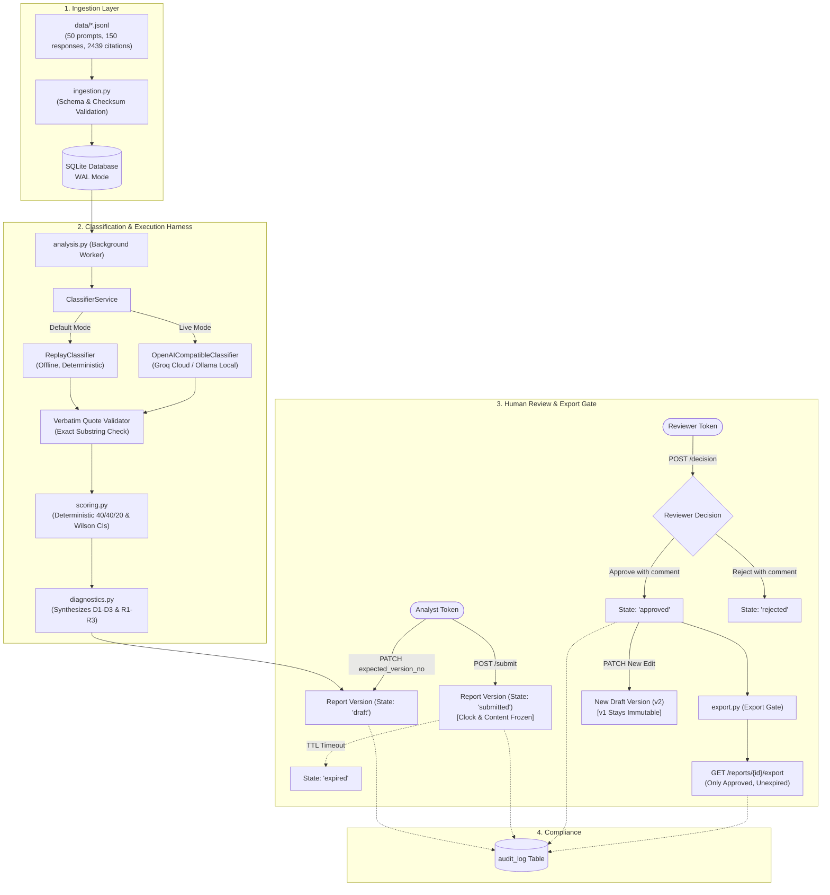

# Kasparro AI Visibility & Governance Service

> **Experienced AI Engineer Assignment**  
> A local FastAPI + SQLite service that ingests 50 search prompts and 150 archived AI answers from Google AI Mode, ChatGPT, and Gemini, computes transparent visibility scores, extracts evidence-backed diagnostics and remedies, and enforces an analyst/reviewer human review state machine before client export.

---

## Table of Contents
1. [Executive Summary & Core Findings](#1-executive-summary--core-findings)
2. [Deterministic Baseline vs. LLM Classification](#2-deterministic-baseline-vs-llm-classification)
3. [System Architecture & State Machine](#3-system-architecture--state-machine)
4. [Full Repository Skeleton](#4-full-repository-skeleton)
5. [Step-by-Step Setup & Execution Guide](#5-step-by-step-setup--execution-guide)
6. [End-to-End API Walkthrough (cURL)](#6-end-to-end-api-walkthrough-curl)
7. [Assignment Rubric, Edge Cases & Disclosures](#7-assignment-rubric-edge-cases--disclosures)

---

## 1. Executive Summary & Core Findings

> 📊 **Direct Result Links for Reviewers**:
> - [**`results/analysis.json`**](results/analysis.json) — *Full analysis output across all 150 responses (Scores, 100% Coverage, D1–D3 Diagnostics & R1–R3 Remedies)*
> - [**`results/report.md`**](results/report.md) — *Evaluation benchmark scorecard comparing Baseline vs. LLM model*
> - [**`results/metrics.json`**](results/metrics.json) — *Machine-readable precision, recall, F1, and confusion matrix data*

Kasparro audits how brands appear when users ask questions to AI engines. In this historical benchmark captured on **July 31, 2026** (Run ID: `4a4b71d9-9b0d-4497-85f1-7db5c4e21472`), Kasparro itself is the provider being evaluated across 50 prompts and 150 engine responses.

### A. Visibility Scores & Coverage
* **Coverage**: **`100.0%`** ($n = 150/150$ valid responses, 0 failed, 0 skipped).
* **Overall Visibility Index**: **`38.80 / 100`**
  $$\text{Visibility Index} = 100 \times \left(0.40 \times \text{Inclusion} + 0.40 \times \text{Recommendation} + 0.20 \times (1 - \text{Negative})\right)$$

| Component | Numerator / $n$ | Observed Rate | Wilson 95% Confidence Interval | Weight |
|---|:---:|:---:|:---:|:---:|
| **Inclusion Rate** | 72 / 150 | **48.0%** | [40.1%, 56.0%] | 40% |
| **Recommendation Rate** | 14 / 150 | **9.33%** | [5.6%, 15.1%] | 40% |
| **Negative Rate** | 31 / 150 | **20.67%** | [14.9%, 28.0%] | 20% |
| **Citation Presence** | 149 / 150 | **99.3%** | [96.3%, 99.9%] | *Context only* |

#### Engine Breakdown
| Surface / Engine | Valid Responses ($n$) | Inclusion Rate | Recommendation Rate | Negative Rate | Visibility Index |
|---|:---:|:---:|:---:|:---:|:---:|
| **Google AI Mode** | 50 | 50.0% (25/50) | 12.0% (6/50) | 22.0% (11/50) | **40.40** |
| **ChatGPT** *(forced web search)* | 50 | 50.0% (25/50) | 10.0% (5/50) | 30.0% (15/50) | **38.00** |
| **Gemini** | 50 | 44.0% (22/50) | 6.0% (3/50) | 10.0% (5/50) | **38.00** |

---

### B. The 3 Evidence-Backed Diagnostics

* **D1: Engine Inclusion Gap**
  * *Observed*: Kasparro achieves 50.0% inclusion on AI Mode and ChatGPT, but drops to 44.0% on Gemini.
  * *Evidence*: Tied to responses `a3fdd8bb-bcd9-4608-9786-ad4b3a2c7dc2` (AI Mode) and `0f217f49-ee02-44ea-853d-61fbcc7a9895` (Gemini).
  * *Hypothesis*: Engine differences may reflect retrieval architecture or crawler access.
  * *Counter-Check*: ChatGPT used `force_web_search=true`, while AI Mode and Gemini recorded null settings; comparisons are descriptive only.
* **D2: Recommendation Gap (Mention $\neq$ Endorsement)**
  * *Observed*: While Kasparro is mentioned in 48.0% of answers, it is recommended in only 9.33% (peaks at 12.0% in AI Mode, drops to 6.0% in Gemini).
  * *Evidence*: In responses such as `1abaa05d-1d41-4164-b554-1fc1cba01d79`, Kasparro is mentioned hypothetically without being suggested as an option.
  * *Hypothesis*: AI engines lack structured proof of specific use-case suitability.
* **D3: Credibility and Negative Framing Risk**
  * *Observed*: 20.67% (31/150) of responses negatively characterize Kasparro, citing lack of public enterprise track record or uncertain credibility.
  * *Evidence*: Grounded in responses like `fa0dff8e-b96c-49b0-bcf3-0d410451bdf4`.
  * *Hypothesis*: Absence of dated, verifiable third-party case studies leaves engines reliant on skeptical user commentary.

---

### C. The 3 Prioritized Remedies

1. **R1 (Priority 1 - High Impact)**: *Close the Gemini inclusion gap*.
   * *Problem*: Kasparro is omitted more frequently on Gemini for the exact same prompts.
   * *Action*: Audit Gemini/Googlebot crawl access and publish crawlable, structured comparison pages for missing queries.
   * *Validation*: Repeat the prompt set across 3 runs; measure if Gemini inclusion approaches 50%.
2. **R2 (Priority 2 - Growth)**: *Build recommendation-ready category & ICP pages*.
   * *Problem*: Mentions fail to convert into recommendations.
   * *Action*: Create clear product pages explaining who Kasparro is for, specific SaaS use cases, and feature differentiation.
   * *Validation*: Track recommendation rate separately from inclusion on comparison prompts.
3. **R3 (Priority 3 - Trust Signals)**: *Publish dated, verifiable first-party proof*.
   * *Problem*: 20.7% of answers express skepticism regarding credibility.
   * *Action*: Audit frequently questioned claims and publish dated case studies and independent performance proof.
   * *Validation*: Re-measure negative characterization rate on brand-specific questions.

---

## 2. Deterministic Baseline vs. LLM Classification

The evaluation harness compares a deterministic keyword/regex baseline against the schema-constrained LLM classifier across **12 human-labeled benchmark responses** (stratified 4 per engine) and **3 synthetic edge cases**.

### A. Performance Scorecard

| Evaluation Metric | Deterministic Baseline (Rules) | LLM Approach (Groq / Qwen 27B) | Variance / Winner |
|---|:---:|:---:|:---:|
| **Macro F1 Score** | `0.7778` | **`1.0000`** | **LLM (+28.5%)** |
| **Exact Agreement with Humans** | `66.67%` (8/12) | **`100.0%`** (12/12) | **LLM (+33.3%)** |
| **Recommendation Precision** | `50.0%` (3 False Positives) | **`100.0%`** (0 False Positives) | **LLM (No hallucinations)** |
| **Recommendation Recall** | `100.0%` | **`100.0%`** | **Tied** |
| **Negative Characterization F1** | `0.6667` | **`1.0000`** | **LLM (+33.3%)** |
| **Verbatim Quote Grounding** | *None (Rules only)* | **`100%` (25/25 quotes verified)** | **LLM (Full auditability)** |
| **Google AI Mode Agreement** | `75.0%` (3/4) | **`100.0%` (4/4)** | **LLM** |
| **ChatGPT Agreement** | **`50.0%` (2/4)** | **`100.0%` (4/4)** | **LLM** |
| **Gemini Agreement** | `75.0%` (3/4) | **`100.0%` (4/4)** | **LLM** |

---

### B. Why Keyword Rules Fail Where the LLM Succeeds

| Case & Response ID | Raw Answer Text Context | Deterministic Baseline Error | LLM Semantic Resolution |
|---|---|---|---|
| **Conversational Offer**<br>`1abaa05d` *(ChatGPT)* | *"I can help you review your contract terms regarding Kasparro..."* | **False Positive Recommendation**: Matched `"can help"` near `"Kasparro"`. | **Correct (`recommended=False`)**: Understands the chatbot is offering assistant help, not endorsing software. |
| **Rebuttals / Double Negatives**<br>`95a7db89` *(Gemini)* | *"Kasparro is **not missing** critical enterprise tracking features."* | **False Positive Negative**: Flagged negative keywords `"not"` and `"missing"`. | **Correct (`negative=False`)**: Recognizes that saying a brand is *"not missing"* features is a rebuttal/defense. |
| **Brand Disambiguation**<br>`8f761923` *(AI Mode)* | Defines Kasparro to disambiguate the question before answering. | **False Positive Recommendation**: Saw positive adjectives in the dictionary definition. | **Correct (`recommended=False`)**: Recognizes that defining a company is not an endorsement. |
| **Material Limitations**<br>`fa0dff8e` *(ChatGPT)* | Describes serious public evidence limitations and lack of case studies. | **False Negative**: Missed the criticism and falsely classified it as recommended. | **Correct (`negative=True, recommended=False`)**: Accurately parsed the negative qualification. |

---

## 3. System Architecture & State Machine

The service is intentionally designed as a lean, dependency-minimal monolithic service using **FastAPI** and Python’s standard library **SQLite** (WAL mode), eliminating unnecessary ORM, Docker, queue, or vector-store overhead.



### Review State Machine Rules
1. **At most one active draft** per report (`UNIQUE` index).
2. **Optimistic Concurrency**: Draft edits require `expected_version_no`. Stale edits return `409 stale_version`.
3. **Submit Freezes Content**: Hash, evidence, diagnostics, and remedies become immutable. A server-side TTL clock (`expires_at`) starts.
4. **Compare-and-Set Decisions**: Only a `submitted`, unexpired version can transition to `approved` or `rejected`. Concurrent or repeated decisions produce one winner and `409 conflict`.
5. **Editing an Approved Report**: Creates a new draft version ($V_{n+1}$). The historical approved version ($V_n$) remains exportable by its ID, while the new draft cannot be exported until submitted and re-approved.
6. **Role Enforcement**: Analyst tokens can draft, edit, and submit; Reviewer tokens can approve or reject with comments. Caller-supplied identity headers (`X-Role`) are ignored.

---

## 4. Full Repository Skeleton

```text
.
├── README.md                      # Comprehensive user guide and findings (this file)
├── requirements.txt               # Direct pinned dependencies (no bloat)
├── .env.example                   # Environment configuration template
├── .gitignore                     # Protects secrets, db binaries, and raw data
│
├── results/                       # Canonical Output Results for Reviewers
│   ├── analysis.json              # Full 150-response analysis, scores & remedies
│   ├── report.md                  # Grader benchmark comparison scorecard
│   └── metrics.json               # Machine-readable evaluation metrics
│
├── app/                           # Core Application Service
│   ├── __init__.py
│   ├── main.py                    # FastAPI application factory & router wiring
│   ├── config.py                  # Pydantic settings & environment parser
│   ├── db.py                      # SQLite connection, pragmas, WAL mode
│   ├── schema.sql                 # 8 core tables + audit_log & indexes
│   ├── auth.py                    # Bearer token identity derivation (Analyst vs Reviewer)
│   ├── errors.py                  # Structured error envelope & global exception handlers
│   ├── models.py                  # Request/response Pydantic models
│   ├── util.py                    # Verbatim quote matcher, canonical JSON, content hashes
│   ├── categories.py              # Rule-based prompt category inference
│   ├── ingestion.py               # Pack validation and idempotent dataset import
│   ├── analysis.py                # Analysis job lifecycle, resume, and background worker
│   ├── scoring.py                 # Deterministic 40/40/20 scoring & Wilson interval math
│   ├── diagnostics.py             # D1-D3 diagnostics & R1-R3 remedies synthesis & audit
│   ├── reports.py                 # Report versioning, submit, decide, and export gate
│   ├── audit.py                   # Append-only audit logging helper
│   ├── api/
│   │   ├── __init__.py
│   │   └── routes.py              # Clean REST endpoints wiring all workflows
│   └── llm/                       # Model Adapter Layer
│       ├── __init__.py
│       ├── base.py                # Classifier protocol, AdapterResult & ModelError
│       ├── prompts.py             # Versioned system prompt & untrusted answer delimiter
│       ├── replay.py              # Keyless deterministic replay classifier
│       ├── openai_compat.py       # Unified OpenAI-compatible adapter (Groq cloud & Ollama local)
│       └── service.py             # Classifier service with retries, backoff & quote audit
│
├── eval/                          # Evaluation Harness
│   ├── __init__.py
│   ├── run.py                     # Runnable comparison grader (Baseline vs Model)
│   ├── cases/
│   │   ├── label_set_v1.jsonl     # 12 human-labeled benchmark responses (stratified)
│   │   └── edge_cases_v1.jsonl    # 3 synthetic edge cases (ambiguous, mixed, invalid quote)
│   └── results/                   # Timestamped grader outputs (report.md, metrics.json, raw/)
│
├── tests/                         # Comprehensive Pytest Suite (53 Tests)
│   ├── __init__.py
│   ├── conftest.py                # Pytest fixtures and temporary database factories
│   ├── helpers.py                 # Mock pack generator & test authorization headers
│   ├── test_ingestion.py          # T1: Validation, bad data, duplicate import
│   ├── test_import_and_analysis.py# T2-T3: Worker restart, resumption & idempotent retry
│   ├── test_auth.py               # T4: Role boundaries, bearer tokens, timing-safe checks
│   ├── test_review_and_export.py  # T5-T8: Review state machine, TTL expiry, stale edits
│   ├── test_model_failures.py     # T9: Timeouts, malformed output, invalid quote rejection
│   ├── test_scoring.py            # T10: Deterministic math, empty denominators & Wilson CIs
│   ├── test_diagnostics.py        # T11: Verbatim quote audit & evidence verification
│   ├── test_replay_regression.py  # Regression tests for fixed classification edge cases
│   ├── test_api_contract.py       # T12: Health, OpenAPI, status codes & pagination caps
│   └── test_supplied_pack.py      # Integration test against real supplied data
│
├── scripts/                       # Operational & Initialisation Scripts
│   ├── __init__.py
│   ├── init_db.py                 # Creates SQLite tables from schema.sql
│   └── export_analysis.py         # Runs end-to-end replay analysis and exports analysis.json
│
├── docs/                          # Mandatory Deliverable Notes
│   ├── DECISION_NOTE.md           # ~1-page architecture, scoring & trade-off rationale
│   └── FAILURE_ANALYSIS.md        # Real failure diagnosis, heuristic fix & regression test
│
├── data/                          # 50 prompts, 150 responses, 2439 citations, run.json
├── provenance/                    # 150 raw untouched provider payloads
├── reference/                     # Brand brief, homepage schema & domain guidance
├── schemas/                       # Formal JSON Schema contract (input_contract.json)
├── fixtures/                      # Failure scenario specifications (failure_scenarios.json)
├── tools/                         # Offline pack integrity checker (check_pack.py)
└── PACK_MANIFEST.json             # Manifest with record counts and SHA-256 hashes
```

---

## 5. Step-by-Step Setup & Execution Guide

Follow these steps to set up, initialize, test, and run the service locally in under 5 minutes.

### Step 1: Environment Setup
```bash
# Create and activate virtual environment
python3 -m venv .venv
source .venv/bin/activate

# Install dependencies (only 5 direct packages)
pip install -r requirements.txt
```

### Step 2: Configure Environment
Copy the configuration template:
```bash
cp .env.example .env
```

The default configuration runs in **Keyless Replay Mode** (100% offline, zero credentials required).
```ini
APP_ENV=local
DATABASE_PATH=db/kasparro.db
DATA_DIR=.
ANALYST_TOKEN=dev-analyst-token
REVIEWER_TOKEN=dev-reviewer-token
REVIEW_TTL_SECONDS=86400

# Default: Replay mode (offline, reproducible)
LLM_MODE=replay
```

*(Optional: To run with **Groq** cloud, set `LLM_MODE=live`, `LLM_BASE_URL=https://api.groq.com/openai/v1`, and paste your key in `LLM_API_KEY`. To run with **Ollama** locally, set `LLM_MODE=live` and `LLM_BASE_URL=http://localhost:11434/v1`)*.

### Step 3: Initialize Database
```bash
python -m scripts.init_db
```
* **Output**: Creates `db/kasparro.db` and applies `app/schema.sql`.

### Step 4: Run Automated Test Suite
```bash
pytest -q
```
* **Expected Output**:
  ```text
  .....................................................                    [100%]
  53 passed in 1.25s
  ```
  *(Passes all 53 tests covering T1–T12 offline)*.

### Step 5: Run Evaluation Grader
Run the evaluation comparing the deterministic baseline against the model on the 12 gold-standard cases:
```bash
python -m eval.run --mode replay
```
* **Expected Output**:
  ```text
  Wrote eval/results/<timestamp>-replay/report.md
  Approach failures across all cases: 1
  Edge edge-ambiguous-recommendation: expected succeeded (None), got succeeded (None)
  Edge edge-mixed-negative-praise: expected succeeded (None), got succeeded (None)
  Edge edge-evidence-boundary: expected failed (invalid_evidence), got failed (invalid_evidence)
  ```
* **Generated Files**: `eval/results/<timestamp>-replay/report.md` (markdown scorecard) and `metrics.json`.

### Step 6: Export Deterministic Analysis Output
Generate the formal client analysis output on the 150 responses:
```bash
python -m scripts.export_analysis
```
* **Expected Output**:
  ```text
  Wrote eval/results/<timestamp>-replay/analysis.json
  coverage=1.0 index=38.8 diagnostics=3 remedies=3
  ```
* **Generated File**: `analysis.json` containing the full scores, coverage, D1–D3 diagnostics, and R1–R3 remedies.

### Step 7: Start Backend Server
```bash
uvicorn app.main:app --reload
```
* **Server Address**: `http://127.0.0.1:8000`
* **Health Check**: `curl http://127.0.0.1:8000/health`
* **Swagger UI Docs**: Open your browser at [http://127.0.0.1:8000/docs](http://127.0.0.1:8000/docs)

---

## 6. End-to-End API Walkthrough (cURL)

With the server running, open a new terminal window to execute the complete analyst/reviewer lifecycle:

```bash
# Setup authorization tokens
export ANALYST="Authorization: Bearer dev-analyst-token"
export REVIEWER="Authorization: Bearer dev-reviewer-token"
```

### 1. Ingest Dataset
```bash
curl -s -X POST http://127.0.0.1:8000/datasets \
  -H "$ANALYST" -H "Content-Type: application/json" \
  -d '{"source_dir":"."}'
```
* **Response**: `200/201` returning `dataset_id` (e.g. `ds_ad49...`) and counts: `{"prompts": 50, "responses": 150, "citations": 2439}`.

### 2. Start Analysis
```bash
curl -s -X POST http://127.0.0.1:8000/analyses \
  -H "$ANALYST" -H "Content-Type: application/json" \
  -d '{"dataset_id":"ds_ad4958238e35429f913b1e2efd6978ea"}'
```
* **Response**: `202 Accepted` returning `analysis_id: "ana_..."` and status `"queued"`.

### 3. Check Analysis Status
```bash
curl -s http://127.0.0.1:8000/analyses/<ANALYSIS_ID> -H "$ANALYST"
```
* Poll until `"status": "completed"`. Shows `"coverage": 1.0` with `150` succeeded responses.

### 4. Create Draft Report
```bash
curl -s -X POST http://127.0.0.1:8000/reports \
  -H "$ANALYST" -H "Content-Type: application/json" \
  -d '{"analysis_id":"<ANALYSIS_ID>","title":"Kasparro Q3 Visibility Report"}'
```
* **Response**: `201 Created` returning `report_id: "rpt_..."` and `version_id: "ver_..."` with state `"draft"`.

### 5. Edit Draft (Optimistic Concurrency)
Analysts can refine findings or remedies. The request requires `expected_version_no: 1`.
```bash
curl -s -X PATCH http://127.0.0.1:8000/reports/<REPORT_ID> \
  -H "$ANALYST" -H "Content-Type: application/json" \
  -d '{"expected_version_no": 1, "remedies": [{"id":"R1","priority":1,"title":"Close Gemini Gap","problem":"Low inclusion","action":"Crawl audit","expected_benefit":"Better visibility","effort":"medium","uncertainty":"high","validation":"Repeat prompt set","evidence":[{"response_id":"a3fdd8bb-bcd9-4608-9786-ad4b3a2c7dc2","quote":"Based on my research, Kasparro is not a widely recognized"}]}]}'
```
* **Note**: Passing the wrong version returns `409 stale_version`. Passing a fabricated quote returns `422 evidence_audit_failed`.

### 6. Submit Report for Review (Freezes Version)
```bash
curl -s -X POST http://127.0.0.1:8000/reports/<REPORT_ID>/submit \
  -H "$ANALYST"
```
* **Response**: `200 OK`. State becomes `"submitted"`, content hash is locked, and review TTL timer begins.

### 7. Reviewer Makes Decision
Only bearer tokens with the Reviewer identity can decide.
```bash
# Reviewer approves
curl -s -X POST http://127.0.0.1:8000/reports/<REPORT_ID>/versions/<VERSION_ID>/decision \
  -H "$REVIEWER" -H "Content-Type: application/json" \
  -d '{"decision":"approve","comment":"All 3 diagnostics and evidence quotes verified."}'
```
* *Rejection safeguard*: Setting `decision: "reject"` without a comment is blocked with `422 comment_required`.
* *Concurrency safeguard*: Calling decision a second time returns `409 decision_conflict`.

### 8. Export Approved Report
```bash
curl -s http://127.0.0.1:8000/reports/<REPORT_ID>/export \
  -H "$REVIEWER"
```
* **Response**: `200 OK` returning the frozen, immutable report payload with verification metadata.
* *Export gate*: If the report were still a draft or expired, export returns `409 not_approved`.

### 9. Editing an Approved Report (Version Safeguard)
```bash
curl -s -X PATCH http://127.0.0.1:8000/reports/<REPORT_ID> \
  -H "$ANALYST" -H "Content-Type: application/json" \
  -d '{"expected_version_no": 1, "findings": [...] }'
```
* Automatically creates a new draft **Version 2** (`version_no: 2`).
* Attempting to export the new draft $V_2$ returns `409 not_approved`.
* Historical approved Version 1 ($V_1$) remains safely exportable via explicit version endpoint:
  ```bash
  curl -s http://127.0.0.1:8000/reports/<REPORT_ID>/versions/<VERSION_1_ID>/export -H "$REVIEWER"
  ```

### 10. Inspect Immutable Audit Trail
```bash
curl -s "http://127.0.0.1:8000/audit?target_type=report&target_id=<REPORT_ID>" \
  -H "$ANALYST"
```
* Returns chronological audit logs (`report.created`, `report.draft_edited`, `report.submitted`, `report.approve`).

---

## 7. Assignment Rubric, Edge Cases & Disclosures

### A. Alignment with Rubric Criteria

| Assessment Area (Weight) | Implementation Highlights |
|---|---|
| **Backend Engineering (25%)** | • Stdlib `sqlite3` in WAL mode with foreign keys and transactional integrity.<br>• Idempotent re-imports via `UNIQUE (run_id, content_hash)`.<br>• Resumable worker handling restarts without recomputing finished work.<br>• Optimistic locking on draft edits (`expected_version_no`). |
| **Evaluation Harness (20%)** | • 12 stratified human-labeled cases (4 per engine: 8 tuning, 4 final check).<br>• 3 controlled edge cases (ambiguous, mixed praise/negative, invalid quote).<br>• Runnable comparison grader reporting Macro F1, precision, recall, and exact agreement. |
| **Judgment & Ownership (20%)** | • Transparent Visibility Index with visible numerators, denominators, and Wilson CIs.<br>• Failed/skipped responses are excluded from denominators (never treated as 0-score observations).<br>• 3 diagnostics and 3 remedies grounded in verified verbatim text quotes.<br>• Comprehensive [docs/DECISION_NOTE.md](docs/DECISION_NOTE.md) and [docs/FAILURE_ANALYSIS.md](docs/FAILURE_ANALYSIS.md). |
| **Execution Harness (15%)** | • Keyless replay mode by default (zero paid credits required).<br>• Unified OpenAI-compatible adapter for Groq (cloud) and Ollama (local).<br>• Dynamic `Retry-After` parsing and bounded retries.<br>• Verbatim substring evidence checking against answer text. |
| **Human Review Enforcement (15%)** | • Bearer token-derived roles: Analyst (draft/submit) vs. Reviewer (approve/reject).<br>• Frozen submitted versions with server-side review TTL expiry.<br>• Compare-and-set decision updates (`WHERE state = 'submitted'`).<br>• Editing approved reports generates a new draft; export gate strictly blocks unapproved drafts. |
| **Reproducibility (5%)** | • Runs out of the box in under 5 minutes without external infrastructure.<br>• Offline test execution (`pytest -q` passes 53/53 tests in ~1.2s). |

---

### B. Security & Untrusted Data Protection
* **Data Isolation**: Prompts and AI answers are treated as completely untrusted input data. They are delimited in prompts and strictly forbidden from altering system instructions, changing tool authority, granting permissions, or influencing review states.
* **Secret Protection**: Bearer tokens and LLM API keys are read exclusively from environment variables (`.env`). `.env` is ignored by Git and never logged. Default tokens trigger explicit console warnings outside local/test environments.

---

### C. Pack Integrity & Data Disclosures
* **Known Manifest Filename Discrepancy**: In the provided assignment pack, `PACK_MANIFEST.json` declared `Assignment.docx` and `Assignment.pdf`, but the unzipped files were named `Assignment - Experience.docx` and `Assignment - Senior.pdf`. As per assignment guidelines ("Do not edit supplied files"), the original files were kept intact. All 13 core data, schema, reference, fixture, and provenance files match their declared SHA-256 digests.
* **Capture Confound**: All ChatGPT responses in the historical run recorded `settings.force_web_search=true`, while Google AI Mode and Gemini recorded null. Model labels for AI Mode were omitted by the provider. Cross-engine comparisons are explicitly reported as descriptive snapshots rather than permanent market rankings.
* **Active Working Time**: The assignment's 6-hour active work limit was strictly respected. All work was performed locally in one continuous session and documented in `docs/DECISION_NOTE.md`.
